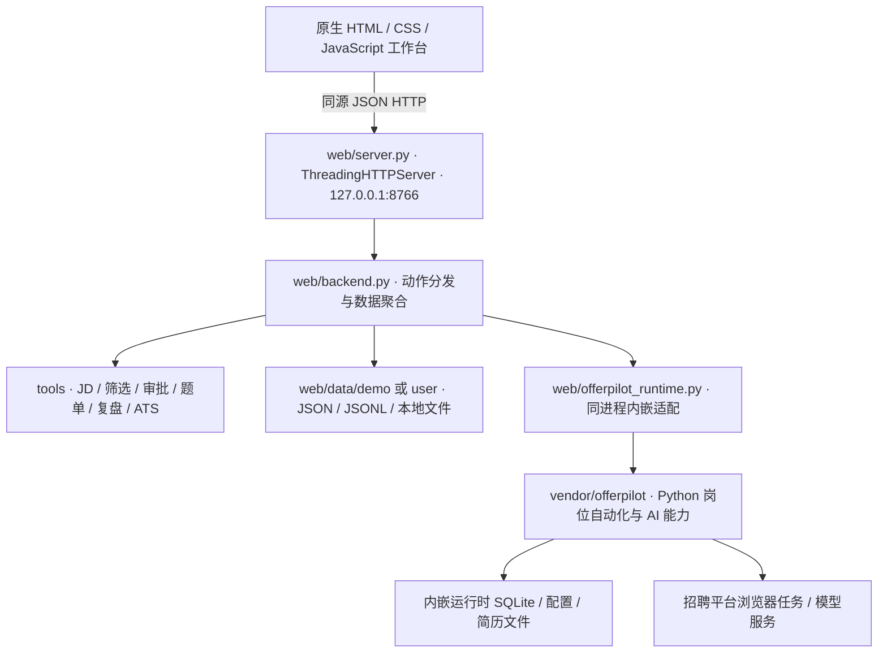
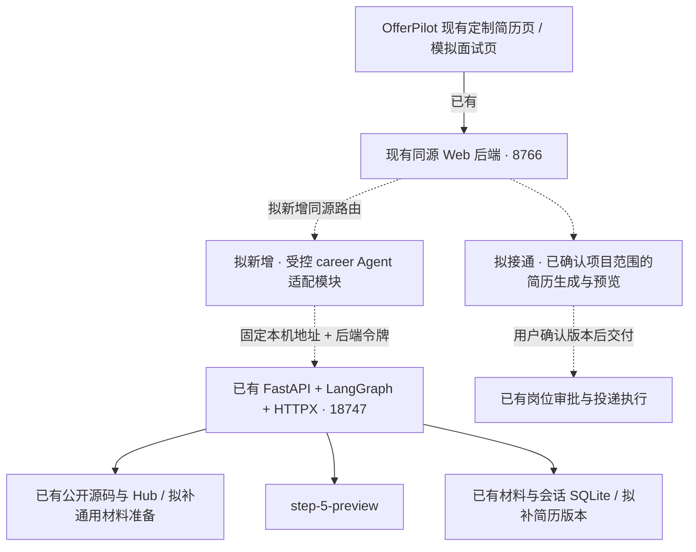

# OfferPilot 架构与定制简历接入评估 v1.0

日期：2026-11-16。范围：只读检查 OfferPilot 与本地定制简历代码、运行离线测试、提出接入方案；未修改两套产品源码，未运行岗位采集或发送，未重新调用付费模型。

OfferPilot 检查版本：`main`，`4c4c6032055566e0bf65ced76f7de71dc45bd0c8`，提交日期 2026-11-15，标题“feat: 审批队列自动通过、高风险拦截与今日联系计划”。这是本次检查的已拉取快照。

## 1. 建议与判断

以 OfferPilot 作为岗位、个人资料和用户操作的工作台，以本地 Python 服务作为源码证据、项目核验、模拟面试和复盘引擎，先通过本机 HTTP 接入。保留现有前端和岗位自动化，不为接入重写整个 OfferPilot 后端。

双方可以互补，但尚不具备“连上接口就完成完整产品”的条件。OfferPilot 已有求职工作台和内嵌简历生成能力，本地已验证材料核验与交互会话；还缺通用项目材料生产、完整 JD 传递、项目组合确认和不可变简历版本。

第一个可验证的接入应是：**在 OfferPilot 的定制简历页完成公开样例项目核验，并在模拟面试页继续同一会话、展示复盘。** 这一步明确标为公开样例，不纳入用户经历；正式基于用户简历的模拟面试放在简历版本保存之后。

## 2. OfferPilot 当前真实结构

- 面板共有七个入口：工作台、求职主线、个人资料、模拟面试、信息推送、定制简历、数据与设置。求职主线另分岗位采集、岗位池、审批队列和 HR 回复。
- 六段主线是 intake、screening、approval、greeting、send、monitor；不是六个独立 Agent 服务。
- 外层 Web 服务使用 Python 标准库 HTTP Server，不是 FastAPI；前端无需构建工具。
- `web/backend.py` 汇总本地文件数据并调用工具；`web/offerpilot_runtime.py` 将 vendored 包装入同一进程，不是向另一个 OfferPilot HTTP 服务转发请求。
- 内嵌组件是 2.4.0 版本，内部有岗位 SQLite、浏览器自动化、模型调用、简历改写和渲染。不能依据早期“纯离线”说明认定整个当前产品没有外部请求。
- 项目当前定位为个人自用、本机运行。它和本地面试引擎都没有完成面向多用户 SaaS 的身份与租户体系。

关键代码：[Web 服务](/D:/上海虹桥黑客松/offerpilot/web/server.py:332)、[六段主线](/D:/上海虹桥黑客松/offerpilot/web/backend.py:100)、[内嵌适配](/D:/上海虹桥黑客松/offerpilot/web/offerpilot_runtime.py:57)。

## 3. 完成情况：已有代码、已验证和缺口

### 工作台及岗位主线

已有代码：结构化个人资料、JD/JSON 导入、岗位池、筛选、评分结果导入、审批、高风险拦截、每日联系计划、招呼语和发送前确认，以及内嵌采集/监控/发送任务入口。

本次验证：在 `git archive` 生成的隔离副本运行仓库规定的 unittest 集合，共 226 项，225 项通过、1 项跳过，无失败。跳过项因隔离副本没有本机 `workspace/resume.md`；不是补造个人简历使测试通过。另通过 `node --check web/static/app.js`。

边界：这些是离线工具、后端与本机 HTTP 契约测试，涉及真实任务的部分使用测试替身；本次没有验证真实平台登录、岗位采集成功率、模型评分质量或实际发送。

### 定制简历

工作台页面已实现经历变体原文保存、结构提示、关键词核对和 PDF/ATS 预检；页面的“定制简历 Agent”仍标记为待接入。

内嵌组件另有真实的 `generate_tailored_resume`、人工草稿保存、Markdown/PDF/PNG 生成、质量与事实完整性检查。外层工作台没有把这一整条生成、预览、审核链路接入当前定制简历面板，不能把 vendor 中存在函数等同于用户已经可以在该页面完成操作。

两处重要限制：

- 母版策略与校验要求保留全部项目，默认不允许删项目或合并；这与我们按岗位选择项目组合的设计需要协调。建议保留完整经历库，用户先确认本次投递范围，再在该范围内生成和校验。不能简单关闭事实校验，也不能让模型自行删除项目。
- 简历产物以公司、职位和岗位 ID 生成固定文件名，再写回岗位的当前路径；同岗位再次保存会更新同一路径。这是当前草稿机制，不是可追溯的不可变简历版本库。

代码：[面板预留](/D:/上海虹桥黑客松/offerpilot/web/static/index.html:796)、[变体保存](/D:/上海虹桥黑客松/offerpilot/tools/variants.py:60)、[母版策略](/D:/上海虹桥黑客松/offerpilot/vendor/offerpilot/src/offerpilot/ai/resume.py:23)、[生成入口](/D:/上海虹桥黑客松/offerpilot/vendor/offerpilot/src/offerpilot/ai/resume.py:1102)、[产物保存](/D:/上海虹桥黑客松/offerpilot/vendor/offerpilot/src/offerpilot/ai/resume.py:989)。

### 模拟面试与复盘

工作台已有从本地题库输出题单、填写文本、粘贴面试记录、规则复盘、题库沉淀与薄弱项统计。外部面试 Agent 同样待接入。

当前 `select_questions(bank, jd_text, cv_text)` 虽然接收 JD 与简历参数，函数体只是题库去重并归入三个预设分段，没有实际利用 JD/简历筛选题目。因此“选择岗位后生成题单”不等于已经实现岗位与项目驱动的面试。

复盘函数明确使用 `offline-deterministic-rules`，没有交互式意图识别、基于源码的回答观察或持久化面试中断恢复。

代码：[面试面板预留](/D:/上海虹桥黑客松/offerpilot/web/static/index.html:643)、[题单选择](/D:/上海虹桥黑客松/offerpilot/tools/mock_interview.py:76)、[规则复盘](/D:/上海虹桥黑客松/offerpilot/tools/interview_debrief.py:105)。

### 其他相关能力

HR 邮件支持用户粘贴后离线解析与日程生成，不等于已连接邮箱；信息推送仍主要是 dry-run 载荷。README、FINAL-RESULT 及部分接口文档保留早期离线版本描述，与当前内嵌自动化代码存在时间差，应以具体入口和当前测试为准。

## 4. 本地定制简历原型可以补上的能力

本地生产调用链已经移除 Pi，采用 Python + FastAPI + LangGraph + HTTPX，模型配置是 `step-5-preview`。旧归档或缓存中的 Pi 名称不是当前运行依赖。

- `github_source`：公开 GitHub 仓库抓取、冻结 commit、清单与文件校验、行级证据引用；当前工具样例是 `pallets/itsdangerous`。这不是用户项目经历。
- 理解产物：已接入验证 Graphify 与 Understand-Anything 相关图谱、导读和源码引用；当前语义产物仍有人工/Agent 准备环节，不是任意仓库一键无人值守解析。
- `interview_hub`：材料、计划、会话、结果、复盘及同一 claim 的历史存储，SQLite 持久化。
- `interview_agent`：FastAPI 本机接口、LangGraph 流程、模型意图识别、基于证据的结构化观察、提示、跳过、暂停、恢复、职责与版本纠正、失败重试和幂等事件。
- 复盘：产生待确认的简历处理建议与补强任务，附源码位置、完成标准和复测建议；不会直接覆盖简历，不将辅助作答视为独立掌握。

本次重新运行本地离线测试：面试运行时 19 项、数据源与 Hub 88 项，合计 107 项通过。此前 `step-5-preview` 真实接口验证记录也已检查，覆盖出题、意图、观察、提示等调用；本次未重新发起模型请求。该验证使用公开项目和合成回答，不代表真实用户能力评估已校准。

当前仍未完成：

- GitHub App/OAuth 仓库授权、私有仓库接入及仓库选择界面。
- 将任意用户项目生产成核验材料的通用流水线与 HTTP 导入接口；现有 `import_demo` 只接受已经准备并验证的固定公开样例。
- 跨仓库项目组合和 Auto Select；目前材料以单一仓库快照绑定。
- 简历正文生成、用户确认、不可变版本保存与 PDF 交付的本地产品链路。
- 回答驱动的动态追问；当前计划开场冻结，最多三题。历史保存的是复盘引用，尚未读取旧复盘正文来有针对性地追问。
- 公司真实面经采集、可信度与时效处理、多轮规律分析。
- 补强任务完成确认、复测结果回写、新简历版本生效的完整闭环。

代码：[接口](/D:/上海虹桥黑客松/interview_agent/api.py:21)、[计划与状态图](/D:/上海虹桥黑客松/interview_agent/graph.py:51)、[样例材料入口](/D:/上海虹桥黑客松/interview_hub/materials.py:11)、[复盘](/D:/上海虹桥黑客松/interview_hub/recap.py:184)。

## 5. 接入前必须正视的四个接口缺口

1. **完整 JD 尚未传递。** OfferPilot 的 `get_jobs` 白名单只返回岗位摘要，未包含 `jd`；从内嵌岗位导入外层工作台时 `raw_text` 被写为空。需增加按岗位取详情的受控适配，冻结完整 JD；不能用公司名和职位名代替 JD，也不能把已有摘要接口直接破坏性改成详情接口。
2. **材料不能通过现有 HTTP 接口创建。** 本地 `/v1/materials` 只有 GET；`StartInterview.target` 仅接收 company、role、round，不能把整个岗位、用户资料或仓库 payload 直接塞进去。需补材料准备接口与校验，不只是前端新增按钮。
3. **正式面试缺少简历版本。** `mock_interview` 必须有 `resume_version_id`；当前公开样例为 null，只能用于 `resume_readiness`。不应随便填一个字符串绕过这条约束。
4. **两边身份和数据模式不同。** OfferPilot 有 demo/user，本地面试服务每个实例是固定 owner。首期用分开的 DB、checkpoint、owner 与令牌/实例进行模式隔离；不能通过浏览器随意传 owner，也不能把真实材料放入公开演示材料库。

证据：[岗位摘要白名单](/D:/上海虹桥黑客松/offerpilot/web/offerpilot_runtime.py:451)、[导入时 raw_text 为空](/D:/上海虹桥黑客松/offerpilot/web/backend.py:1668)、[输入约束](/D:/上海虹桥黑客松/interview_agent/models.py:11)、[正式面试门槛](/D:/上海虹桥黑客松/interview_agent/repository.py:19)。

## 6. 建议接入结构与数据归属

上图实线表示已存在的组件调用，虚线表示建议新增的接线；框内“拟补”能力不表示已经实现。数据源中的 Graphify/Understand-Anything 产物由材料准备环节使用，不是每一次用户回答都重新通读全部仓库。

- OfferPilot 保持个人资料、岗位、投递审批和实际执行记录的归属；本地引擎负责证据、claim、核验观察、会话及复盘。
- 工作台只保存关联信息并按需查询结果，不把面试 SQLite 再完整复制成一套 JSON 真相源。
- 个人资料保持完整，项目组合是某份投递简历的选择结果。回答不足先产生补强、降级表述或排除建议，用户确认后生成新版本。
- 保存最少关联：data_mode、外层 job_id、已有 offerpilot_id、job_snapshot_id、profile_snapshot_id、project_snapshot_id、claim_id、material_id、resume_version_id、session_id。材料和版本一经绑定不得悄悄变更。
- 现有 profile 的项目主要以名称等内容表示，不能把同名项目直接当同一项目。稳定项目关联及仓库/职责确认放在新模块，不直接向会丢弃未知字段的 profile 中硬塞凭据或大量图谱。
- 代码存在、用户参与、独立讲清、可以写成哪种简历表述是不同结论。提交记录仅作线索；没有职责确认和证据的个人成果保持待核实。

前端继续访问同源 `/api/...`。OfferPilot 当前 CSP 只允许 `connect-src 'self'`，直接从浏览器请求 18747 会受限制，也会把服务令牌暴露给前端。桥接模块使用固定目标地址、明确操作白名单和后端持有的令牌，不提供任意 URL 代理。

当前模型调用最长可达 120 秒且可能重试。接入需展示处理中、阻止重复提交，并根据接口超时返回可恢复状态；重新加载应读取同一会话，重试沿用同一个 event_id，不新建会话或重复提交答案。

持久化恢复继续遵循已用的 LangGraph 机制：同一 thread_id、持久化 checkpointer、`Command(resume=...)` 恢复中断，失败恢复与中断恢复分开；中断节点会从头执行，副作用不能放在可重复执行的位置。已通过 Context7 CLI 核对 [LangGraph interrupts](https://docs.langchain.com/oss/python/langgraph/interrupts) 与 [checkpointers](https://docs.langchain.com/oss/python/langgraph/checkpointers) 当前文档；本次没有据此升级依赖或改写已验证代码。

## 7. 最小接口与实施顺序

以下是建议契约，**均不表示 OfferPilot 已提供这些新路由**。

### 第一步：接通已有样例核验

- 新增独立桥接文件，例如 `web/career_agent_runtime.py`，在 `web/server.py` 增加独立路由分支；不让新功能混入 send/monitor 事件。
- `GET /api/resume-agent/materials` → 现有引擎 `GET /v1/materials`，首期只展示公开样例。
- `POST /api/interview-agent/sessions` → `POST /v1/interviews`，使用 `mode=resume_readiness`。
- `GET /api/interview-agent/sessions/{id}` → `GET /v1/interviews/{id}`。
- `POST /api/interview-agent/sessions/{id}/turns` → 已有 turns 接口。
- `GET /api/interview-agent/sessions/{id}/recap` → 已有 recap 接口。
- 定制简历页放核验启动、当前问题和证据；模拟面试页按同一 session_id 继续并显示复盘。用户不必重新选择项目、重复输入资料。

验收：一份公开样例在 OfferPilot 页面完成启动、回答、暂停、刷新恢复、提示、结束和复盘；断开引擎显示可理解的连接状态；演示不能读到用户材料；不触发真实岗位发送。

### 第二步：完成一个用户项目的业务链路

- 从岗位详情冻结 JD，从现有 profile 提取专业事实，接入一个用户确认的仓库快照与贡献说明；缺失 JD/职责时明确待补。
- 在 Python 材料侧新增通用准备入口，完成证据校验与材料版本冻结，再启动 readiness 会话。
- 核验后展示“建议保留、需改写、建议补强、建议排除”及理由；用户确认本次项目范围。
- 先复用 OfferPilot 已有渲染能力，接通预览和导出；生成器只能读取已确认的事实与范围。现有完整母版策略和完整性校验需适配该范围，不能全局改写或覆盖其他岗位的母版配置。
- 在引擎侧新增不可变简历版本：保存 Markdown、导出物摘要、岗位/JD/资料快照、选择的 claim 与证据及确认时间。外层工作台存版本关联，不将同岗位可覆盖草稿路径作为版本 ID。
- 以该 resume_version_id 生成新的绑定材料，开启 `mock_interview`；复盘关联本次简历版本，旧版本和旧会话保持可查。

验收：一个真实用户项目从资料确认到核验、简历预览、确认保存、正式模拟面试、复盘全部可追溯。版本变化产生新版本/会话绑定；用户未经确认不会被认定参与某仓库或被自动删项目。

### 第三步：扩展既定差异化

先完成跨仓库项目库和按岗位推荐组合，支持用户锁定/排除项目并解释推荐原因，组合结果可保存复现；不是随机抽项目。随后接 GitHub 授权与私有仓库、历史薄弱项驱动的追问和补强复测，再引入带来源与时间的公司面经研究。

公司面经不是本次接线的前置条件，也不能用当前没有的数据宣称已经掌握公司考察规律。

## 8. 代码边界与集成验证

后续实现时遵守仓库 `CLAUDE.md` 的模块边界：只改定制简历、模拟面试的页面区块及相关函数，桥接逻辑放新模块；不顺手重构其他岗位逻辑。

- 保持 `/api/state` 的 27 个顶层键及既有动作语义；新能力通过独立接口读取。
- `/api/pipeline/event` 只接受 send/monitor，不拿它保存面试答题、简历生成或核验分数。
- 新路由增加 HTTP 测试：数据模式隔离、非法来源、引擎不可用、令牌不回显、重复事件、版本冲突和暂停恢复。
- 核验结果不得直接改变审批/投递成功状态；简历可投与岗位已发送分别记录。
- 若桥接后允许实时模型调用，补一次真实端到端验证，并明确使用样例或用户材料；离线测试通过不能替代页面验证或真实平台验证。
- Windows 下 `run_web.sh` 的 `.venv/bin/python` 是 Unix 路径；当前测试使用现有 Python 3.11 环境运行。后续接入需补 Windows 启动入口，不应直接认定仓库脚本可在 PowerShell 原样启动。
- 内嵌组件附带 `PolyForm Noncommercial 1.0.0` 许可。当前源代码可供本次架构检查；若作为商业服务复用，需要先核对其许可适用范围与授权。

## 9. 验证记录

- [OfferPilot 本次测试日志](/D:/上海虹桥黑客松/outputs/offerpilot-review-20261116/tests.log)：226 项，225 通过，1 跳过。
- [本地 Agent 本次测试日志](/D:/上海虹桥黑客松/outputs/offerpilot-review-20261116/local-agent-tests.log)：19 项通过。
- [本地数据源与 Hub 本次测试日志](/D:/上海虹桥黑客松/outputs/offerpilot-review-20261116/local-source-hub-tests.log)：88 项通过。
- [此前真实模型验证](/D:/上海虹桥黑客松/outputs/interview-agent/live-verification.json)：公开项目、合成回答，非真实用户能力校准，本次只检查记录。
- OfferPilot 检查前后工作区 clean；测试在 `outputs/offerpilot-review-20261116/source` 的快照副本执行，未读写真实用户运行时。

本报告是接入评估与可执行顺序，不是已完成集成的声明。
