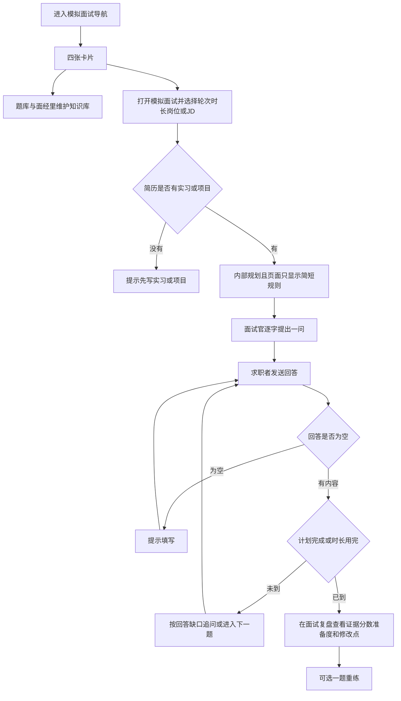
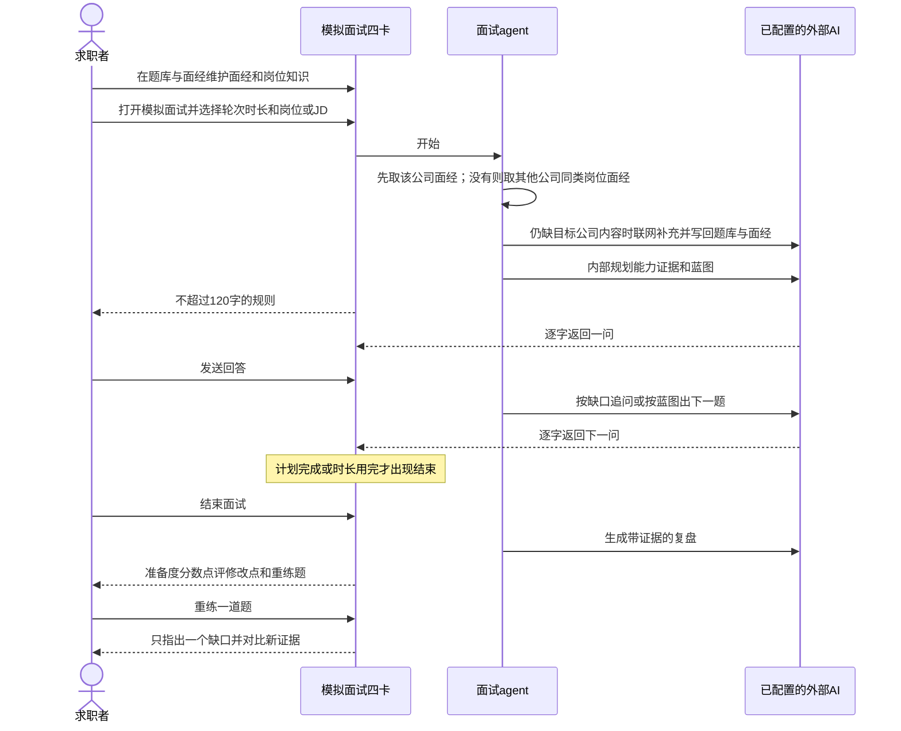

# 秋招规划师
status: Confirmed

> **入口变更（2026-11-18）**：本文描述的「四张卡片」文字模拟面试现在位于「模拟面试」页的第三个标签「题单与本地题库」。页面默认打开的是「1v1 综合模拟面试室」，说明见 `web/COMPREHENSIVE-INTERVIEW.md`。下文中「进入模拟面试后先看到四张卡片」（含 AC-016）指的是进入该标签之后，不再是进入「模拟面试」导航时的首屏。其余需求与验收不变。

## 用户目标与完整流程

使用者是求职者本人，在本机工作台的「模拟面试」里做文字练习。这是面试前的训练和复盘，不是正式面试中的实时提词。

进入「模拟面试」后先看到四张卡片，版式与工作台核心流程卡片相同：序号、眉标、标题、说明、一个本地计数、状态胶囊。点卡片进入对应模块，并可返回四张卡片。四块是：模拟面试、Mock 题单、面试复盘、题库与面经。模拟面试里只有本场对话。Mock 题单仍只从本地题库取题。面试复盘放结束后的准备度复盘和原逐字稿复盘。题库与面经放持续维护的面经、岗位知识，以及原补充题库。逐字稿复盘仍然只摘录显式证据。面试过程中不点评。

开始前选择面试轮次和时长，并可选择岗位、粘贴 JD。面经和岗位知识不在这一场里上传，也不在开始时勾选，只在「题库与面经」里维护。轮次为 HR、业务专业、技术口述、主管之一。时长为 20 或 30 分钟，默认 30 分钟。简历里至少要有一条实习或项目，否则不能开始。没有 JD 时可以开始，页面标明「本轮是通用岗位模拟」。没有岗位也没有 JD 时，不用其他公司的面经出场景题。

点开始后，agent 在内部完成岗位能力、简历证据映射和本轮提问蓝图，页面不展示这些内容。页面只显示不超过 120 字的规则：时长、轮次、一次只问一个问题、过程中不点评、结束后统一复盘。然后第一问逐字出现。

面试中一次只问一个问题，不说明考查意图，不给答题框架，不逐题夸奖或纠正。追问由上一句回答的缺口触发，例如场景不具体、只说「我们」、没有指标、没有取舍、只讲成功或前后不一致。同一主问题最多追问 3 次。模拟面试的出题依据来自「题库与面经」里的知识库，以及联网搜索补充的内容。本场有岗位或 JD 时，优先使用该公司的面经和岗位知识。该公司没有面经时，使用其他公司相同或相似岗位的面经，用来理解这个岗位要考的能力，再据此提问。这些条目标明来自其他公司的同类岗位，不当成目标公司的业务，也不当成候选人已经做过的事。知识库仍然缺少目标公司业务或岗位职责时，面试官联网搜索来补充，并把搜到的内容写入知识库，标明来自联网，用户之后可以改。搜不到或搜索失败时继续这场面试，页面说明这次没有联网补充，不改用套话，不编造公司业务。没有岗位也没有 JD 时，只深挖简历。面经和联网结果只用来决定更可能问什么，不当成公司官方标准。不编造简历里没有的经历。

本轮计划问完，或设定时长用完后，才出现「结束面试」。时长用完时，当前这一问可以答完，之后不再出新题。在此之前不提供结束。点结束后统一复盘。

复盘包含：准备度（Ready、Almost ready、Needs practice、Insufficient evidence）和一句理由；各项能力的 1–5 分、权重、直接证据、缺失证据和置信度；逐题点评和建议回答结构；一个最优先修正项；简历修改点；1–3 道可重练的题。没有这场回答里的证据，不得用表达流畅补分。简历修改点只留在复盘里，不写入定制简历。

复盘后可以选一道题重练。每次只改一个缺口。重答后对比新增了什么证据、仍缺什么。同一题最多 3 次，然后换成相邻问法。重练示范只重组已经说过的事实，缺数字时写「请补充真实数字」，不编造。

进行中可以重新开始。未完成的一场不生成复盘。已经生成的复盘保留。

记录和知识库存在本机。生成问题和复盘时，本场用到的知识库内容会发给已配置的外部 AI。联网搜索只补充知识库里还没有的目标公司或岗位内容。密钥不写入仓库。失败时明确提示，不改用套话。半句中断时保留并标明未完成，可以重试。已提交的回答保留。

## 本次范围

本次交付：

- 文字对话，问题逐字出现。按所选轮次和 20 或 30 分钟安排，不再固定 10 问。
- 内部规划岗位能力和简历证据，页面不展示题库和评分答案。
- 面试中只提问和追问。出题依据是题库与面经里的知识库，以及联网补充。该公司没有面经时，用其他公司相同或相似岗位的面经理解要考的能力。
- 结束后给出带证据的分数、准备度、点评、一个优先修正项和简历修改点。
- 可选一道题重练，每次只改一处，同一题最多 3 次。
- 「模拟面试」导航下是四张卡片：模拟面试、Mock 题单、面试复盘、题库与面经。面经和岗位知识只在题库与面经里维护。开始一场面试时不上传、不勾选。联网补充写入知识库并可再改。

本次不做：

- 语音、摄像头、代码执行、白板和作品集演示。
- 正式面试中的实时提词。
- 预测录用或保证 Offer。
- 把简历修改点自动写入定制简历。
- 用口音、语速或镜头表现主导能力分。
- 登录、多人面试、单独的历史对话列表。

## 需求与验收

### REQ-001 按轮次和时长进行文字模拟面试

- 用户结果与主流程：求职者选择轮次和时长后开始。先看到简短规则，再逐字回答问题。计划完成或时长用完后才能结束。
- 业务规则、权限、数据归属与状态（适用时）：内部蓝图不展示。面试中不教学。追问针对上一句缺口，同一主问题最多 3 次。知识库不在一场面试的开始步骤里上传或勾选，维护入口在「题库与面经」。有本场岗位或 JD 时，优先使用该公司面经和岗位知识；该公司没有面经时，使用其他公司相同或相似岗位的面经来理解要考的能力。知识库仍缺目标公司业务或职责时联网补充并写回。没有岗位和 JD 时只深挖简历，并标明通用岗位模拟。状态为未开始、准备中、面试中、可结束、已复盘、重练中。
- 业务前置条件：简历中至少有一条实习或项目，并且已配置外部 AI。轮次和时长已选择。
- AC-001：选择业务专业、30 分钟，简历有实习，不选岗位、不粘贴 JD。页面不出现考查点或分数表，开始步骤里也没有面经或岗位知识的上传和勾选。规则说明不超过 120 字。第一问深挖简历经历。回答含糊后，下一问追问该句里的缺口，而不是换一个无关主题。验证方式：走两问并查看页面。
- AC-002：知识库里已有一份与本场岗位相关、含独特业务场景的面经或岗位知识。开始时不勾选它。本轮至少出现一问简历深挖，和一问使用该场景、且不是要求复述简历经历的场景题。验证方式：走完本轮后查找这两问。
- AC-003：不再验收「在一场模拟面试里上传」。知识库条目离开页面后仍留在本机，见 AC-014。
- AC-014：在「题库与面经」里新增一条面经或岗位知识，离开后再进入，该条目仍在，并且可以修改或删除。模拟面试的开始步骤里没有上传入口。验证方式：在题库与面经新增后重新进入，再打开模拟面试查看开始步骤。
- AC-015：本场选择了岗位或 JD，知识库里既没有该公司面经，也没有可用来理解该岗位能力的其他公司同类岗位面经。面试官联网补充，并把结果写入知识库，标明来自联网。之后可以改这条。搜不到或搜索失败时，这场面试继续，页面说明这次没有联网补充，不出现编造的公司业务。验证方式：用一份库中不存在的岗位走一场，分别看搜索成功和失败。
- AC-004：简历没有实习或项目时不能开始，并提示先写实习或项目。验证方式：清空后点开始。
- AC-005：不粘贴 JD 时，页面标明本轮是通用岗位模拟，仍可开始。粘贴含独特场景的 JD 并选中岗位时，页面显示该公司和岗位名，且至少有一问使用这份 JD 的场景。验证方式：分别走无 JD 和有 JD 两场。
- AC-006：空白回答不发送，并提示填写。验证方式：提交空内容。
- AC-007：计划未完成且时长未用完时，没有「结束面试」。计划问完或时长用完后才出现。时长用完时当前问可答完，之后不再出新题。验证方式：在开场后立即查看；再用短时长走完一场。
- AC-008：重新开始会替换未完成的对话且不生成复盘。已完成复盘仍保留。验证方式：完成一场后再开一场并中途重来。
- AC-009：对话进行中可以返回四张卡片，并分别打开 Mock 题单、面试复盘和题库与面经。这三块仍按原规则可用。模拟面试模块里不再同时堆着这三块。验证方式：进行中返回入口并分别打开。
- AC-010：未配置 AI 或第一问失败时不进入面试中。半句中断时保留、标明未完成、可重试，已发送回答还在。不改用套话。验证方式：未配置时开始一次，进行中模拟中断一次。
- AC-016：进入「模拟面试」导航先看到四张卡片：模拟面试、Mock 题单、面试复盘、题库与面经。卡片含序号、眉标、标题、说明、一个本地计数和状态胶囊，版式与工作台核心流程卡片相同。点开模拟面试后，页面没有知识库表单，也没有题单和复盘面板。验证方式：从导航进入并点开模拟面试。
- AC-017：目标公司在知识库中没有面经，但有其他公司相同或相似岗位的面经。本轮用后者所体现的能力来提问，并标明不是该公司的面经。不把其他公司的业务说成目标公司的业务，也不说成候选人的经历。验证方式：准备两家公司的同类岗位面经，只选没有面经的那家走一场。

### REQ-002 带证据的复盘、简历修改点和重练

- 用户结果与主流程：结束后看到准备度、能力分数、逐题点评、一个优先修正项、简历修改点和可重练的题。然后可以只重练一道题。
- 业务规则、权限、数据归属与状态（适用时）：1–5 分必须附这场回答中的直接证据。证据不足时该能力标为证据不足，不用流畅度补分。准备度只表示练习准备程度，不表示录用结论。简历修改点不写入定制简历。重练每次只针对一个缺口，同一题最多 3 次，示范不新增未说过的事实。
- 业务前置条件：本轮已结束。
- AC-011：复盘中每个分数都能看到对应的回答证据或「证据不足」。准备度为四档之一，并有一句理由。验证方式：用缺少结果的回答走完一场。
- AC-012：复盘列出简历修改点，并能对上对话里的项目或经历。定制简历正文在结束前后不变。验证方式：结束前后查看定制简历。
- AC-013：从复盘进入一道题的重练。第一次重练只提示改一个缺口。第 4 次不再重复同一问法，而换成相邻问法。重练文案不出现候选人没说过的数字。验证方式：对同一题连续重练。

## 流程图与时序图

### 用户流程图

关联 REQ-001、REQ-002。

### 核心交互时序图

## 界面约定

入口仍是左侧「模拟面试」（`#view-interview`）。进入后先是四张卡片，复用工作台核心流程的 `pipeline-node`：序号、眉标、标题、说明、计数、状态胶囊。四张为模拟面试、Mock 题单、面试复盘、题库与面经。点卡片进入该模块，并可以返回四张卡片。模拟面试的开始步骤只有轮次、时长、岗位和 JD。知识库的新增、修改和删除在题库与面经。结束后的准备度复盘在面试复盘，不堆在对话下面。进度改为剩余时间，不再显示「第 n / 10 问」。视觉复用现有流程卡片，不另做一套颜色。

## 待确认事项

1. 已确认：文字对话；题单、逐字稿复盘和补题库保留；空白回答不发送；重新开始不给未完成的一场出复盘；材料留在本机；失败不改用套话。
2. 已确认：考查点和面试蓝图不展示。没有 JD、面经和岗位职责时只深挖简历。没有简历实习或项目时不开始。没有 JD 时标明通用岗位模拟。
3. 已确认（2026-11-16，依据用户提供的 SOP，并选择三项）：复盘增加 1–5 分和准备度，分数必须带这场回答的证据。复盘后可以重练一题，每次只改一处，同一题最多 3 次。一场按轮次和时长安排，不再固定 10 问。轮次为 HR、业务专业、技术口述、主管；时长为 20 或 30 分钟，默认 30 分钟。
4. 已吸收：面试中不讲解、不给框架、不逐题点评。追问由回答缺口触发。场景题来自材料中的业务和职责。面经不当作公司官方标准。不做正式面试提词，不预测录用。
5. 已确认（2026-11-17）：面经和岗位知识不在一场模拟面试里上传或勾选。它们是用户持续维护的本机知识库。开始时不勾选。库里没有能覆盖的内容时联网补充，结果写入知识库并标明来自联网，之后可以改。搜不到时继续面试并说明没有联网补充。联网不编造简历经历，也不当成公司官方标准。AC-003 的「在一场里上传」不再验收。
6. 语音、摄像头、代码白板不纳入本次。
7. 已确认（2026-11-17）：「模拟面试」导航下改为四张流程卡片：模拟面试、Mock 题单、面试复盘、题库与面经。模拟面试的出题依据是题库与面经里的知识库，以及联网搜索。目标公司没有面经时，用其他公司相同或相似岗位的面经理解该岗位要考的能力，并标明不是该公司面经。没有岗位也没有 JD 时，仍只深挖简历。见 AC-016、AC-017。
