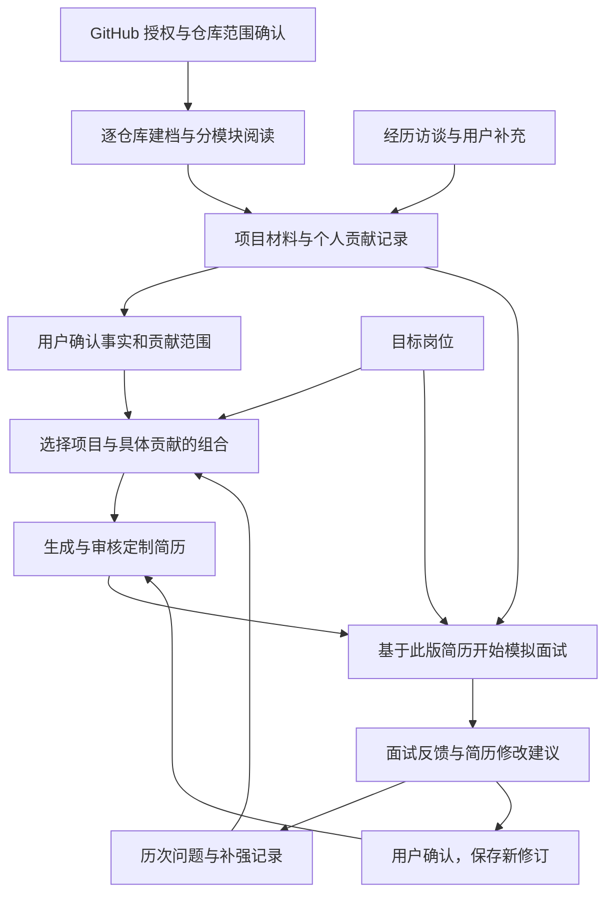

# 定制简历 · GitHub 数据源与模拟面试联动 v0.3

日期：2026-11-14  
目标用户：应届生／初级求职者。  
状态：本文为早期服务设计。后续已完成公开仓库分析、本地模拟面试材料接口及合成输入的复盘验收，见[接口与复盘 v0.7](./定制简历_模拟面试资料接口与复盘服务_v0.7.md)；GitHub 账号与真实模拟面试引擎尚未接入。

2026-11-15 更新：[GitHub 授权库与项目前置核验 v0.4](./定制简历_GitHub授权与项目前置核验_v0.4.md)将项目核验前置到首次生成简历之前，补充 Graphify／Understand-Anything 的工具分工、逐条表述建议与补强复测。本稿原有 GitHub 阅读范围、贡献归属、按岗位选材和面试反馈继续保留，完整流程以 v0.4 的新增前置步骤衔接。

本轮补充：面试结果持续沉淀到具体经历，形成补强与复测记录；面向不同岗位动态选择项目和贡献组合。「随机」暂按用户上下文理解为随岗位变化、可提供不同组合，每项选择需要有依据。

用户已确认保存并纳入：参考 Teal Auto-Select 的按岗位自动选材、有完成条件与复测的补强任务、跨仓库项目归并与人工调整、已投递或已面试版本的固定保存。完整规格见[自动选材与已确认功能](./定制简历_自动选材与已确认功能.md)。这些是已确认需求，尚未实现。

新增设计方向：由 Agent 主动研究公司与岗位的公开招聘资料和面经，支持按轮次组织模拟面试。详见[公司研究与多轮面试设计](./定制简历_公司研究与多轮面试设计.md)，本轮已进行少量来源核对，尚未建立公司规律库。

本稿补充 v0.2，纳入用户新增的两项要求：GitHub 作为数据源，Agent 通读项目；定制简历与模拟面试双向连通。v0.2 中「外部平台连接后续评估」和仅做简短追问的协作范围，在本稿中更新。原有经历访谈、用户审核、预览、导出和版本管理继续保留。

## 1. 服务定位与完成标准

**从用户授权的项目和个人贡献中选出适合岗位的组合，用同一份材料开展模拟面试，积累反馈与补强记录，再把用户确认的改进用于下一版简历。**

这条路径优先服务有 GitHub 项目的求职者。没有 GitHub 项目的用户仍可使用原有的课程、社团、实习等经历访谈入口。

本轮按以下顺序设计与验证：

1. 明确项目阅读范围 → 每个仓库有快照、阅读状态、覆盖清单和材料来源。
2. 明确个人贡献如何进入简历 → 项目整体事实与用户本人贡献分别记录，并由用户确认。
3. 明确面试如何使用简历和项目 → 问题关联同一版简历、目标岗位与项目快照。
4. 明确反馈如何回写 → 展示修改差异，经用户采纳后创建新版本，保留原面试记录。

## 2. 总体服务流程

简历与模拟面试共用项目档案。面试服务按需读取关联的材料片段，无需用户再次上传整份资料。

## 3. GitHub 数据源：连接与范围

### 用户操作

- 连接 GitHub，确认本次允许读取的仓库范围；支持所授权范围内的全部仓库，也支持指定仓库。
- 对团队仓库、组织仓库和外部开源贡献，允许用户补充相关仓库或 PR 链接，在可访问范围内读取。
- 确认与本人关联的贡献记录，说明角色以及未体现在提交中的设计、调研、测试或协作工作。

### 接入建议

采用 GitHub App，申请完成导入所需的仓库只读权限。具体接口权限在实现时逐项核对；产品不需要仓库写入权限。仓库选择与账户授权分别处理，不能将可以读取的公共项目直接视为本人的作品。

GitHub App 支持按资源选择权限，官方建议申请所需的最小权限。[GitHub App 权限说明](https://docs.github.com/en/apps/creating-github-apps/registering-a-github-app/choosing-permissions-for-a-github-app)

### 读取的材料

- 项目说明、目录结构、依赖配置、设计文档。
- 业务源码、关键执行路径、测试和与项目理解有关的配置。
- 与本人贡献相关的 commits、PR 及可访问的讨论记录。
- 用户主动补充的角色说明、项目成果和未进入仓库的材料。

导入按只读分析设计，不执行仓库脚本。仓库内的文字和代码作为待分析材料，不作为 Agent 操作指令。

## 4. “通读所有项目”的服务定义

通读范围以用户确认的仓库集合及每个仓库的选定分支快照为准，默认使用该分支当前提交。历史变更用于补充本人贡献线索；不要求一次读取全部历史文件版本。

### 第一阶段：全量盘点

列出授权范围内全部仓库，建立目录与文件清单，记录快照提交、项目类型、是否 fork、初步用途和可读取状态。仓库列表与文件清单必须处理分页和截断，不以一次请求返回的数据代替全集。

### 第二阶段：逐仓库分模块阅读

按模块阅读本项目业务源码、测试和文档，整理入口、主要功能、执行关系与设计线索。文件较长时分段阅读，保留片段位置，再整合为模块与项目说明。

第三方依赖目录、生成产物和二进制文件登记为排除项，记录原因。子模块、LFS 对象、无法读取的文件和超出当前处理能力的材料单独标记，不能静默算作已读。

可以根据目标岗位优先安排相关项目，但其他已选择仓库继续排队处理。用户能看到每个仓库的进度并恢复中断任务。

### 第三阶段：围绕简历候选经历复核

对拟写入简历的功能、技术动作和贡献范围，回查具体文件、相关测试及本人变更记录，生成材料引用。技术设计的真实动机、个人角色和业务效果没有材料时，转为问题向用户确认。

### 用户可见的分析结果

每个仓库展示：处理状态、快照时间、已分析范围、待处理项、排除项及原因。只有范围内业务源码和文档按清单处理完成，才能标记为「约定范围阅读完成」。完成阅读仍不代表已经运行、部署或验证项目效果。

GitHub 的递归目录接口可能返回截断标记，官方要求在需要完整目录时继续逐子树获取。这是设计覆盖清单与未完成状态的依据之一。[Git Trees API](https://docs.github.com/en/rest/git/trees)

后续重新扫描时，以仓库快照识别变化，复核受影响的材料与结论。已有简历和面试继续保留其使用的旧快照，不被新代码静默改写。

## 5. 从项目材料到个人简历

项目档案分别记录三类信息：

1. **项目事实**：仓库在某一快照中实现了什么，出处在哪里。
2. **个人贡献线索**：相关提交、PR 和讨论涉及哪些变更，以及如何关联到用户。
3. **用户确认的经历**：用户实际负责的职责、决策、工作动作和交付结果，并注明哪些为本人补充。

仓库归属、提交作者或提交次数，都不能单独证明用户独立完成了整个项目。fork、教程、模板、多人协作与 AI 辅助均需准确说明实际贡献。GitHub 提交数据可提供作者、提交者和文件变更等线索，角色归属还需结合其他材料与用户确认。[Commits API](https://docs.github.com/en/rest/commits/commits)

每条重要简历表述关联：对应岗位要求、来源材料、项目快照、个人贡献范围及用户确认状态。源码引用保留提交标识、文件路径和具体位置；PR 与讨论保留相应引用。

生成规则：

- 依赖列表中出现某技术，只能作为阅读线索；需要结合实际使用位置和本人工作判断是否适合写入简历。
- 项目整体有缓存、重试等功能，不代表这些功能均由用户负责。
- 代码或测试存在，不直接证明测试已通过、系统已上线或性能已提升。
- 性能数字、用户规模和业务效果必须有对应记录或明确标为用户提供，未经用户确认不能进入最终正文。
- star 数和提交数量可以作为项目背景材料，不转换为个人能力评分。

## 6. 定制简历 → 模拟面试

### 用户入口

在已确认的简历版本中选择「基于此版简历开始模拟面试」。用户确认使用的岗位、项目与材料范围，系统自动带入相关内容。

### 交给面试模块的内容

- 已确认的简历版本和其中的重要经历表述。
- 目标岗位及岗位要求快照。
- 相关项目快照、源码与变更材料引用。
- 已确认的个人贡献，以及仍需要准备的问题。
- 与本次经历相关的历史问题、用户采纳的修改、补强记录与复测结果；没有历史记录的经历保持为尚未评估。

面试会话固定这些版本。会话期间仓库或简历发生更新，不改变本次面试所依据的内容。

### 面试服务行为

问题围绕目标岗位、简历声明、项目实现与个人职责展开。例如：项目解决什么问题；某段逻辑如何处理失败；有哪些方案取舍；哪一项工作由本人负责。

每个项目问题保留对应的简历表述、材料引用和考察目的。没有材料记载的设计动机，应向用户提问，不能预先编造为标准事实。仓库尚未完成阅读的部分不作为已确认事实出题。

模拟面试的能力反馈与材料核对分别呈现。答不清可能是知识、表达、记忆或材料不完整的问题，不能据此直接认定经历虚假。

## 7. 模拟面试 → 定制简历

面试模块返回与具体简历表述关联的反馈：

- **补充新细节**：用户说明了原简历遗漏的决策、困难或交付物，建议新增经历材料。
- **澄清职责范围**：回答显示原文混合了团队成果与个人职责，建议调整表达。
- **改善表达**：已有事实正确，建议让动作与结果更清楚。
- **准备待办**：用户需要进一步理解或整理的内容，记录为练习项，不自动改成简历事实。

反馈应包含对应表述、相关回答、材料依据、修改理由和建议文本。用户查看前后差异后，选择采纳、编辑或保留原文。

采纳后更新经用户确认的经历记录，并创建新简历修订。原版本和面试记录保持不变。新增自述若尚无仓库材料，仍标为用户补充，不伪装成源码结论。

## 8. 团队对接的最小约定

实现前先对齐以下标识和内容，字段名可结合整体项目调整：

- `project_snapshot_id`：仓库、选定提交、分析覆盖范围与材料引用。
- `contribution_id`：用户确认的个人工作、来源材料及确认状态。
- `resume_version_id`：岗位快照、最终正文、每条表述与贡献材料的关系。
- `interview_session_id`：本次面试固定使用的简历版本、岗位及项目快照。
- `claim_id`：一条具体经历表述及其来源，跨简历修订保留关联，便于把反馈落到具体内容。
- `improvement_id`：一个待澄清或待补强的问题，关联面试记录、材料、处理任务与后续复测。

简历模块向面试模块传递上述上下文和允许使用的材料引用。面试模块回传关联具体表述的反馈与修改建议。双方共用材料记录，避免各自生成互不一致的项目事实。

撤销数据源访问后停止后续同步。删除材料时明确是否同时删除其派生记录和快照；需要清理的关联内容按用户选择处理。私有源码与材料不自动随简历 PDF 导出或公开分享。

## 9. 首轮联调与验收

首轮使用用户明确选择的样例仓库，跑通以下完整过程；产品设计仍支持已授权范围内全部仓库逐个处理。

1. 仓库扫描 → 有实际源码引用、项目说明、覆盖范围和可恢复状态。
2. 贡献确认 → 明确区分项目整体能力和用户本人工作。
3. 岗位简历 → 重要表述关联已确认贡献与稳定材料引用。
4. 模拟面试 → 自动带入同版简历、岗位与项目；问题关联实际材料。
5. 面试反馈 → 展示一次事实补充或职责澄清，用户采纳后生成新修订。

必须覆盖的反例：

- 仓库属于团队，缓存由队友完成，重试由用户完成 → 不将缓存归为用户独立贡献。
- fork 或模板含完整功能 → 不把原仓库全部代码当作用户产出。
- 仓库列表分页、目录截断或文件无法读取 → 显示未完成范围，补齐前不宣称通读完成。
- GitHub 尚未接入或扫描中断 → 已确认的手工经历仍可继续使用，失败仓库可恢复处理。
- 面试中发现原表述范围不准确 → 提出建议，由用户决定是否修改。
- 面试期间仓库更新或简历另存新版本 → 本次会话继续引用原快照，不混用材料。

以上是待实现的服务验收要求，尚无接入或运行验证结果。

## 10. 面试结束后持续沉淀什么

### 记录落在具体经历与表述上

每次面试结束，保留对应的简历与项目快照、问题、关键回答、所引用材料、问题类型、处理建议和用户决定。反馈关联到具体职责、技术动作或项目成果，不能只留一个总体分数。

同一项目可以同时包含用户讲得清楚的部分和仍待准备的部分。一次对缓存的回答不充分，不能自动否定该项目中已确认的前端、测试或协作贡献。

后续面试继续引用相关记录：重复出现的问题追加新观察，已经处理的问题记录后续表现，避免反复生成相同待办。一次表现改善只说明本次相关问题已讲清，不代表永久掌握整个技术领域。

相关实现或职责发生变化时，历史记录仍显示其使用的版本；新版本的准备情况需要复核，不能直接沿用旧的复测结论。

### 分清问题，再提出行动

1. **表达不清**：已有事实与材料相符，但职责、过程或结果没有讲清。建议整理讲述顺序，用自己的话说明具体动作，再进行相关追问。
2. **理解不足**：对相关实现机制或取舍暂时无法展开。建议阅读具体模块、梳理执行过程、完成适合该岗位的小修改或验证，再复测。
3. **材料不充分或对照不一致**：先检查引用版本、扫描覆盖和关联位置；必要时补充设计稿、Issue、测试记录或其他材料，再判断原表述是否需要调整。材料缺失不能直接解释为工作没有发生。
4. **职责范围不准确**：用户确认某项工作由队友负责，或原表达超出了实际工作。建议改为本人实际职责；不能形成合适表述时，建议从当前简历移除该条内容。

一个反馈可以同时涉及多种问题，但需分别说明依据。系统推测与用户确认的事实分开记录。用户暂时记不清或一次答错，不直接触发删除。

### 从提醒转成可完成的补强任务

每个任务至少写清：对应简历内容、具体薄弱点、要查看的材料、需要完成的动作、完成后如何检查。

虚构示例：用户在「负责接口失败重试」这一项上无法说明触发条件。

- 查看与当前项目快照对应的重试入口、错误分类和测试。
- 说明哪些错误会重试、何时停止，以及重复请求的影响。
- 根据实际项目完成一个相关小测试或验证步骤。
- 用一个不同的失败场景再次回答，记录是否能独立解释。

补强过程可记录为「待确认 → 补强中 → 待复测 → 本次复测已改善」。用户自行标记完成与实际完成复测分别展示；没有复测结果时不自动改为已掌握。

### 删除的范围

默认建议对象是当前岗位简历中的某条表述或某个项目展示。用户可以选择保留、改写、替换项目或移除；操作前显示影响内容，确认后生成新修订。

从简历移除不自动删除 GitHub 仓库、原材料、项目档案或历史面试记录。用户另行删除个人数据时，沿用明确的关联删除范围。

## 11. 面向岗位动态组合项目

### 先区分仓库、项目与个人贡献

一个实际项目可能由前后端等多个仓库组成；一个仓库也可能包含多个练习。允许用户确认项目归并关系，再从具体个人贡献中选材，避免把同一项目拆成多段重复经历。

首版可以由用户手动确认这些关系，无需先开发复杂的自动归并系统。

### 组合需要使用的材料

- 经用户确认的岗位要求与优先项。
- 项目和具体贡献所能支持的职责、技术动作、协作与交付物。
- 来源材料是否充分、个人职责是否明确。
- 相关面试中哪些部分已讲清，哪些仍待准备，以及最新补强状态。
- 本次简历的篇幅、用户指定必须保留的项目，以及已有内容是否重复。

未参加过面试的项目标为「尚未评估」，不因缺少历史记录而自动降低选择机会。有薄弱点的项目也可以选取其中已确认的其他贡献。

### 首版采用可解释的选择顺序

1. 先选有个人贡献依据、能对应岗位关键要求的内容。
2. 在多个候选之间，优先选择能提供不同能力依据的组合，减少重复描述。
3. 结合相关表述的面试与补强记录，提示准备事项；不让一次面试表现覆盖其他材料。
4. 在约定篇幅内安排项目顺序和表述重点，允许用户锁定、移出或替换项目。
5. 展示每个项目的入选原因、对应岗位要求、尚需准备的内容；说明其他项目未选中的具体原因。

岗位要求没有材料支持时显示缺口，不以更换措辞假装满足。学历等项目本身无法替代的条件，与项目覆盖情况分开说明。

### 多种组合与稳定版本

相同岗位、相同材料和相同用户选择，应能恢复原来的组合方案。用户主动请求其他方案时，可以提供强调职责贴合度、技术细节或协作交付的不同候选，并说明取舍依据。

组合会随岗位、材料或补强情况变化。已经保存或用于投递的版本保持原样，另存新版本记录变化。内容变化有可追溯原因，不采用无解释的随机抽样。

虚构示例，以下选择均以已确认的本人贡献为前提：

- 前端岗位：校园商城的表单与交互贡献，加上可视化看板的图表交互贡献。
- 后端岗位：任务调度项目的重试机制贡献，加上校园商城的接口开发贡献。
- 某项目的技术细节暂时讲不清：保留其中可说明的实际工作，针对薄弱点提供准备任务；用户也可以在本次简历中换用其他项目。

## 12. 已确认补充的功能与验收

用户已确认在已设计的基础上增加以下三项，并复用 Auto-Select 的按岗位自动选材逻辑：

1. **有完成条件与复测的补强任务**：用户能在一条经历下看到问题、具体行动、完成条件和复测结果。
2. **跨仓库项目归并与人工调整**：同一项目不重复计算经历；用户可以锁定、排除或替换推荐项，调整后重新检查岗位覆盖与篇幅。
3. **固定保存已投递或已面试版本**：对应正文、岗位、项目快照和面试记录保持关联，后续改进另存新修订。

第三项中的投递去向可先由用户手动记录，不扩展为自动投递或招聘平台集成。

新增验收场景：

- 同一条表述在两次面试出现相同问题 → 历史观察可追溯，追加记录，不重复创建无关联待办。
- 用户说不出一个模块，但同项目其他贡献清楚 → 提醒针对具体表述补强，不自动移除整个项目。
- 源码引用错误版本或尚未读完 → 先定位材料缺口，不直接要求删除真实经历。
- 用户确认原表述超出本人职责 → 展示改写或移除建议，采纳后创建新修订。
- 补强任务自行标记完成但尚未复测 → 显示待复测，组合建议保留准备提醒。
- 更换目标岗位 → 使用同一份事实库重新组合项目，展示选择理由，不改写事实本身。
- 没有面试历史的新项目 → 保持尚未评估，可以凭已有贡献与材料进入候选。
- 同一项目分布在多个仓库 → 用户确认归并后，简历不将其重复计为多个独立项目。
- 恢复已投递版本 → 展示原正文、项目材料和关联记录，不被后续训练或仓库更新覆盖。

这些仍是设计与验收要求，未开展实际功能验证。

## 13. 公司差异、公开面经研究与多轮面试

首版归属建议：主要入口放在模拟面试准备环节，公司与岗位研究作为简历和面试共用的模块，在同一应用内实现。独立产品入口与单独部署后续按实际需要评估，详见[服务归属与首版形态](./定制简历_公司研究与多轮面试设计.md#10-服务归属与首版形态建议)。

用户提供公司与岗位后，Agent 自主检索适用资料，区分官方说明、候选自述、转载、备考与模拟内容，整理带来源与适用范围的观察。样本不足时保留未知，不将公开提及比例解释为真实被问概率。

公司研究用于解释项目选材和轮次训练重点，个人事实仍来自已确认贡献与材料。同一次求职机会可以关联多个轮次，每轮可以多次练习，反馈继续进入既有经历与补强记录。

新增对接内容为一次求职机会、公司研究快照和轮次标识。后续轮次默认使用已投递简历，用户确认更新外发版本后才切换。具体资料样例、服务规则和验收场景保存在[公司研究与多轮面试设计](./定制简历_公司研究与多轮面试设计.md)。
